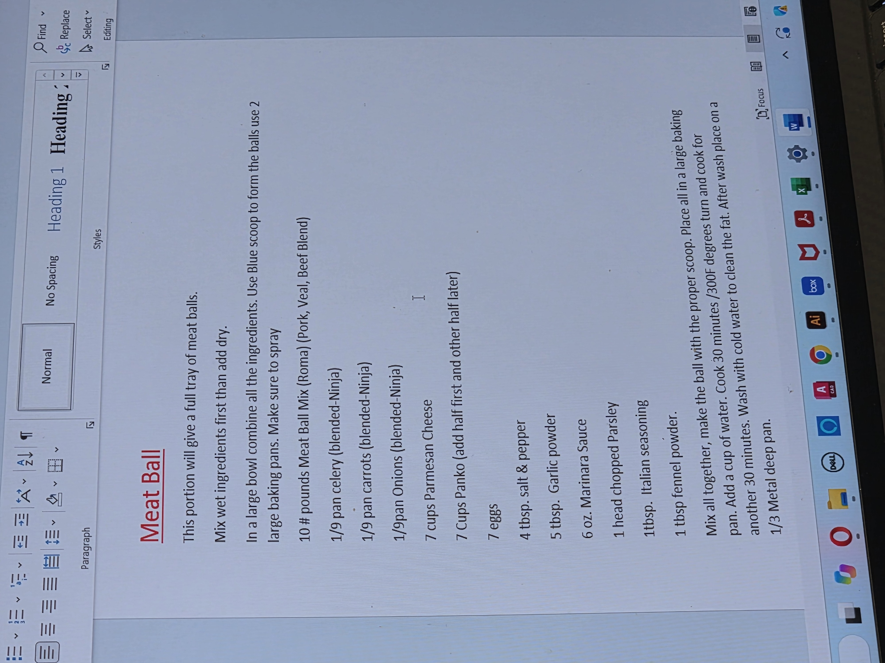

# Flairantini Notes

## Table of Contents

- [Tarantini Italian Restaurant](#tarantini)
  - [Menu Items](#menu-items)
    - [Pasta](#pasta)
      - [Sausage & Broccoli Rabe Ravioli](#sausage-broccoli-rabe-ravioli)
      - [Ravioli con Funghi](#ravioli-con-funghi)
      - [~~Rigatoni alla Vodka~~](#rigatoni-alla-vodka)
      - [~~Fettuccine Alfredo~~](#fettuccine-alfredo)
      - [Capellini Pesto](#capellini-pesto)
      - [Penne Rustica](#penne-rustica)
    - [Vitello](#vitello)
      - [Veal Marsala](#veal-marsala)
      - [Veal Saltimboca](#veal-saltimboca)
    - [Pesce](#pesce)
      - [~~Salmon Aurora~~](#salmon-aurora)
      - [~~Shrimp Scampi~~](#shrimp-scampi)
      - [~~Shrimp & Pea Risotto~~](#shrimp-pea-risotto)
      - [~~Halibut Livornese~~](#halibut-livornese)
      - [~~Halibut Piccata~~](#halibut-piccata)
    - [Pollo](#pollo)
      - [Pollo Marsala](#pollo-marsala)
      - [Pollo Rollatini](#pollo-rollatini)
    - [Pizza](#pizza)
    - [Side Dishes](#side-dishes)
  - [Prep](#prep)
    - [Breadcrumbs](#breadcrumbs)
    - [Potato Croquettes](#potato-croquettes)
    - [Meatballs](#meatballs)
    - [Pizza Dough](#pizza-dough)
    - [Large Lasagna](#large-lasagna)
    - [Brocolli Rabe](#brocolli-rabe)
    - [Sauces](#sauces)
      - [Bolognese Sauce](#bolognese-sauce)

- [Flair Modern Cuisine](#flair)
  - [Menu Items](#menu-items)
    - [Brunch](#brunch)
    - [Dinner](#dinner)
  - [Prep](#prep)
- [Both Restaurants](#both)
  - [Menu Items](#menu-items)
  - [Prep](#prep)

# **_Tarantini_**

## **Menu Items**

## Pasta

### Sausage Broccoli Rabe Ravioli

<p align="center">
  
</p>

```markdown
Recipe (In Order):

- 4 Broccoli Ravioli
- 2 Oz of Olive Oil
- 1/3 Cup of Sliced Sausage
- 1 Tbsp Fresh Garlic
- 2 Oz of White Wine
- 10-12 Oz Broccoli Rabe
- 3 Oz Butter
- Pinch of Salt+Pepper

Process:

1. Immediately put 4 Brocolli Ravioli in boiling water
```

### Ravioli con Funghi

<p align="center">
  
</p>

### Rigatoni alla Vodka

### Fettuccine Alfredo

### Capellini Pesto

<p align="center">
  
</p>

### Penne Rustica

<p align="center">
  
</p>

## Vitello

### Veal Marsala

<p align="center">
  
</p>

### Veal Saltimboca

<p align="center">
  
</p>

Gets Potato Croquettes unless Sub Pasta

```markdown
Recipe:

- 1 Slice Veal
- A Dusting of Flour
- 2 Oz Blend Oil
- 1 Slice Prosciutto
- 1 Slice Fresh Mozzarella
- 3 Oz Butter
- 1 Tbsp Garlic
- 3 Oz Artichoke
- 3 Oz White Wine
- 8 Oz Beef Stock (Dine In)/12 Oz (Carryout)
- 2 Cups Spinach
- 2 Potato Croquettes
- Pinch of Parsley

Process:

1. Put Blend Oil in a pan, dust the Veal in flour, and sear it
2. When that's done: put Nonstick Spray on a sizzle tray, cut the Veal in half and top with the Prosciutto and Mozzarella. Place in the oven until top is gold.
3. Start the sauce: In a pan add the Butter and Garlic and cook until gold/crispy. Then add Artichoke.
4. Deglaze with White Wine and add Beef Stock
5. In another pan, lightly sautee the Spinach with some Olive Oil and Garlic.
6. To Plate: Pour all the sauce, center the Spinach, set the Veal on top, add 2 potato croquettes.
7. Goes on a PLATE, finish with Parsley
```

## Pesce

### Salmon Aurora

### Shrimp Scampi

### Shrimp Pea Risotto

### Halibut Livornese

### Halibut Piccata

## Pollo

### Pollo Marsala

<p align="center">
  
</p>

### Pollo Rollatini

<p align="center">
  
</p>

## Pizza

## Side Dishes

## **_Prep_**

### Breadcrumbs:

```markdown
Recipe:

- 4.5 Lbs of Panko
- 3.5 Lbs of Parmesan Cheese
- 2 Cups of Parsley
- 1/2 Cup of Granulated Garlic
- 1/2 Cup of Salt+Pepper
- 1/3 Cup of Italian Seasoning

Process:

- Use an 18 Qt container
- Weight out the Panko and Parmesan 2 Lbs at a time in a metal bowl because the scale can only handle so much.
- Shake it really well
```

### Potato Croquettes:

<p align="center">
  
</p>

```markdown
Recipe:

- 20 Large Potatoes
- 4 Egg Yolks (Save the whites for Parm Station)
- 7 Cups Parmesan Cheese
- 3 Tbsp Parsley
- 4 Tbsp Garlic Powder
- 4 Tbsp Salt+Pepper

Process:

1. Boil the potatoes until you start seeing the skin come off, then pour them into a collander. Set aside a huge bowl for the next step.
2. With a bar towel and a hot potato in one hand and a steak knife in the other, scrape off the skin. Remove any ugly bits and eyes.
3. Use the masher and mash all of the potatoes in the bowl, then add all of the ingredients.
4. Mix it by hand the rest of the way, breaking up as many solid bits you can by squeezing them in between your fingers.
5. On 2 large (unsprayed) metal trays, use a Green scoop to portion them all, then roll them all at once onto one tray.
```

### Meatballs:

<p align="center">
  
</p>

```markdown
Recipe:
```

### Pizza Dough:

<p align="center">
  
</p>

```markdown
Recipe:

- 2 x 25 Lb Bags of Flour
- 50 Degree Water filled to the line in 18 Qt container
- 2 Cups of Canola Oil
- 2 Cups of Sugar + 1.5 Cups of Salt in a 1/6th pan
- 2 Ounces of Yeast by weight

Process:

1. Add the hook before ingredients
2. Add in this order: Water, Flour, Salt+Sugar, and Yeast
3. Crank the bowl up and ENSURE the speed is set at 1
4. Mix for 2 minutes ("shaggy ball"), then add Canola Oil
5. Mix for another 5 minutes at speed 1
6. Turn speed up to 2 and mix for another 6 minutes

Notes:

- Ball Weights:
  - Small: 7 Ounces (12 per tray)
  - Medium: 14 Ounces (8 per tray)
  - Large: 22 Ounces (6 per tray)
- Typical batch breakdown:
  - 2 Trays Small
  - 3 Trays Medium
  - The rest Large
```

### Large Lasagna

<p align="center">
  
</p>

### Brocolli Rabe

```markdown
Process:

1. Cut the bunch in thirds
2. Trash the bottom 1/3rd, Keep the top 1/3rd, and pick out the big sticks from the middle 1/3rd and keep what's good
```

## Sauces

### Bolognese Sauce

<p align="center">
  
</p>

### Piccata Sauce

<p align="center">
  
</p>

### Marsala Sauce

<p align="center">
  
</p>

### Alfredo Sauce

<p align="center">
  
</p>

---

# **_Flair_**

## **Menu Items**

## Brunch

## Dinner

## **_Prep_**

---

# **_Both_**

## **Menu Items**

## **_Prep_**
